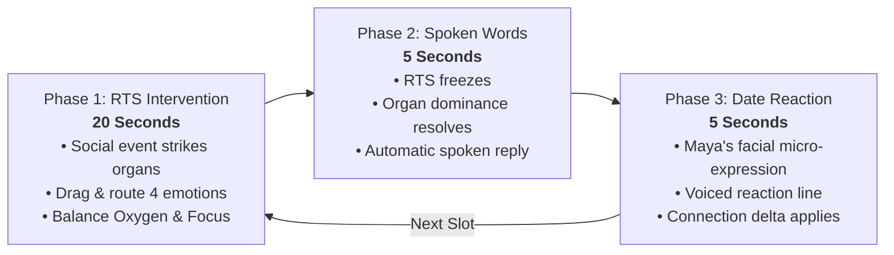

# CTRL + HEART (CTRL-Heart)
### *An Autonomic Dating Sim × Real-Time Emotional Command Center*

[](https://mastersk.itch.io/ctrl-heart)
[](https://unity.com/)
[](https://unity.com/srp/universal-render-pipeline)
[%20%7C%20macOS%20%7C%20Windows-success.svg)](https://mastersk.itch.io/ctrl-heart)
[-brightgreen.svg)](#content-scale--the-10-slot-arc)
[](LICENSE)

> *"Balance your internal organs. Steady your pulse. Win Maya's heart."*

<p align="center">
  <a href="https://mastersk.itch.io/ctrl-heart">
    
  </a>
</p>

---

## 📸 Screenshots & Showcase

<p align="center">
  
</p>

<p align="center">
  
  
</p>

---

## 💡 The Core Concept

In **CTRL+HEART**, you are not the protagonist. **You are the command center inside a deeply nervous person's autonomic nervous system** while they attempt to survive a high-stakes first date at an outdoor café with Maya.

### The Non-Negotiable Rule
**You never choose dialogue options from a menu.**
Dialogue is the automatic, emergent readout of whatever emotional balance your real-time organ management produces. Social situations trigger physiological crises; you route limited internal emotional affects under strict time pressure; and the resulting organ dominance decides what clumsy, bold, witty, or disastrous words spill out of your character's mouth.

### The Central Loop
```
Social Situation (Date Beat)
            ↓
Internal Physiological Crisis (Organ Strain)
            ↓
Real-Time Emotional Routing (Drag & Drop Affects)
            ↓
Dominant Autonomic State (Single or Mixture)
            ↓
Spoken Dialogue & Tone (Unfiltered Output)
            ↓
Date Reaction & Connection Delta (Maya's Response)
```

---

## 🎮 Gameplay & Turn Structure

Every conversation turn is structured into a disciplined **30-Second Turn Loop**:



### 1. Phase 1: RTS Intervention (20.0s)
* Maya speaks, asks a question, or shares a non-verbal gesture (e.g., glancing away, noticing awkward posture, laughing at a near spill).
* A **Social Event Profile** strikes one or more internal organ nodes (e.g., *Panic*, *Heart Flutter*, *Awkward Silence*, *Sweat Surge*).
* The player actively drags emotional units from their tray onto nodes using **Oxygen** to counteract the stress and shape the resulting mental state.

### 2. Phase 2: Spoken Words (5.0s)
* RTS controls freeze.
* The game evaluates the dominant emotion (or mixture) across the primary organ nodes.
* Your character speaks their automatic response line matching that exact psychological balance.

### 3. Phase 3: Date Reaction & Connection Delta (5.0s)
* Maya reacts in real time with dynamic sprite animations (blushing, teasing, skeptical eyebrow raise, warm smile, or cold shutdown).
* Your **Connection** meter increases or drops based on how well your response resonated with her personality and context.

---

## 🧠 The Internal Command System

<p align="center">
  
</p>

### The 5 Anatomical Nodes

```
             [ BRAIN ]
             /       \
       [ VOICE ]   [ HEART ]
          |           |
       [ BODY ]    [ LUNGS ]
```

| Node | Biological Function | When Overwhelmed / Depleted |
|:---|:---|:---|
| **Brain** | Logic, memory, thinking, generates **Focus** | Focus regen collapses; complex mixture answers become locked |
| **Lungs** | Respiration, generates **Oxygen** | Oxygen recovery halts; deploying new affects becomes impossible |
| **Heart** | Emotional pulse, modulates **Composure** | Tachycardia, anxiety spikes; Composure plunges toward **Meltdown** |
| **Voice** | Articulation & delivery | Stuttering, mumbling, hesitant vocal delivery |
| **Body** | Physical posture & autonomic response | Shaking, sweating, fidgeting; critical failure forces **Frozen / Blank** silence |

---

### The 4 Emotional Units (Affects)

| Emotion | Visual Hue | Primary Function | Overuse Consequence |
|:---|:---:|:---|:---|
| **Calm** | 🔵 Blue | Stabilizes heart rate, repairs damaged nodes, grounds composure | Slow to act; can sound emotionally detached or aloof |
| **Anxiety** | 🟣 Purple | Rapid response speed; intercepts sudden social threats | Stresses composure, accelerates heart rate, causes stammering |
| **Confidence** | 🟡 Yellow | Boldness, assertive delivery; essential for playful teasing | Can easily come across as arrogant or patronizing |
| **Attraction** | 🔴 Coral / Red | Amplifies romantic chemistry, vulnerability, and intimacy | Leads to premature oversharing or intense, awkward intensity |

---

### The 4 Internal Resources

| Resource | Core Question | Generated By | Critical Consequence |
|:---|:---|:---:|:---|
| **Oxygen** | *"Can I keep my autonomic systems operating?"* | **Lungs** | At `0`, cannot deploy emotional units onto nodes. |
| **Focus** | *"Can I formulate nuanced, thoughtful replies?"* | **Brain** | At `0`, restricts dialogue strictly to the 4 basic emotions (mixtures disabled). |
| **Composure** | *"How close am I to losing all control?"* | **Heart** | At `0`, triggers an immediate **Autonomic Meltdown** defeat! |
| **Connection** | *"How well is the date actually going?"* | **Dialogue Flow** | At `0`, Maya leaves, triggering **Date Collapse** defeat! |

---

## 🧪 Mixture Detection & Emergent Personality

CTRL+HEART features a mathematical **Emotional Mixture Engine**:
* If two emotions on the primary target node are within **15 percentage points** of each other **AND** both exceed **25% individual influence**, they blend into a compound psychological state:

```
    Calm + Confidence    → Controlled Charm / Quiet Assurance
    Calm + Attraction    → Gentle Warmth / Vulnerable Sincerity
    Anxiety + Confidence → Nervous Bravado / Overcompensating Swagger
    Anxiety + Attraction → Flustered Crushing / High-Strung Romantic
    Calm + Anxiety       → Supressed Panic / Tense Stoicism
    Confidence + Attraction → Playful Flirtation / Magnetic Banter
```
* **10 Total Distinct Spoken States** per scenario + the **Frozen / Blank** override if the physical Body crashes!

---

## 🏁 The 5 Distinct Endings

Depending on your accumulated Connection score and whether your Composure survives all 10 slots:

| Ending Archetype | Condition | Outcome |
|:---|:---:|:---|
| 🏆 **Second Date Confirmed** | Connection Tier 3–4 at Slot 10 | *"I honestly had the best time today. Let's do this again soon—I'll text you tonight!"* |
| ☕ **The 'Maybe' Zone** | Connection Tier 2 at Slot 10 | *"Thanks for coffee! It was really nice getting to know you. Take care!"* |
| 😬 **Awkward Ending** | Connection Tier 1 at Slot 10 | *"Well... I should probably get going before traffic starts. Safe travels home..."* |
| 💔 **Date Collapse** | Connection hits `0` at any time | *"You know what... I just remembered I have an emergency appointment. I have to leave now."* |
| 🚑 **Internal Meltdown** | Composure hits `0` at any time | *"Are you okay?! You look like you're about to pass out! Do you need an ambulance?!"* |

---

## 📚 Content Scale & Architecture

All narrative content is authored directly in pure C# data tables ([FullDateContent.cs](Assets/Scripts/Core/Testing/FullDateContent.cs)) without runtime JSON/database dependencies:

- **10 Complete Conversational Slots** detailing the entire date arc from awkward arrival to bill payment.
- **40 Scenarios (4 Connection Tiers per Slot)** adapting dynamically to how much Maya likes you.
- **440 Spoken Player Lines** (10 psychological states + Frozen/Blank for every scenario).
- **440 Tailored Date Reactions** with bespoke dialogue and animation triggers.
- **920+ total lines of authored narrative prose**!
- **38 Hand-Crafted Character Animation Sheets** covering natural resting idle, talking cadences, romantic blushes, playful smirks, and skeptical eye-rolls ([Catalog](Available-Animations-Catalog.md)).

---

## 🚀 How to Play

### 🌐 Option 1: Play Instantly in Your Browser (Recommended)
The full game is deployed and freely playable on **itch.io** with no installation required:

👉 **[Play CTRL+HEART on itch.io (https://mastersk.itch.io/ctrl-heart)](https://mastersk.itch.io/ctrl-heart)**

*Supports Chrome, Safari, Firefox, Edge, and modern desktop/tablet browsers.*

---

### 🛠️ Option 2: Open and Run in Unity Editor

#### Requirements:
* **Unity 6** (`6000.3.9f1` or compatible Unity 6 release)
* Universal Render Pipeline (URP) installed via Package Manager (configured in `Packages/manifest.json`)
* Git LFS (`git lfs install && git lfs pull`) to ensure all textures, audio, and sprites are downloaded.

#### Steps:
1. Clone the repository with Git LFS enabled:
   ```bash
   git clone https://github.com/SarthakKanade/CTRL-Heart.git
   cd CTRL-Heart
   git lfs pull
   ```
2. Open **Unity Hub** -> **Add Project from disk** -> Select the project root folder.
3. In the Unity Project window, open `Assets/Scenes/MainMenuScene.unity`.
4. Press **Play** ▶ in the editor to experience the full date with ambient café audio, procedural UI, and animated sprites!

---

## 📂 Project Architecture

```
CTRL-Heart/
├── Assets/
│   ├── Animations/               # Date character animations (Maya's 38 animation sheets)
│   ├── City Date-a-bgm-asset-pack/# Ambient café background music playlist
│   ├── Medieval Ui/ & RPG Packs/ # Pixel art UI sprites, buttons, panels, and frames
│   ├── Scenes/
│   │   ├── MainMenuScene.unity   # Interactive main menu with How-To-Play & Roadmap modals
│   │   ├── MainDateScene.unity   # Full 10-slot dating & RTS simulation scene
│   │   └── Phase0_VerticalSlice.unity # Standalone debug / mechanics verification scene
│   ├── Screenshots/              # High-resolution game captures and UI documentation
│   └── Scripts/Core/
│       ├── Audio/                # AudioFeedbackManager (ambient BGM, heartbeat SFX, UI audio)
│       ├── Data/                 # SimulationMath, NodeState, ResourceState, EndingsData
│       ├── Systems/              # GameManager, MindMapManager, ResourceManager, SocialEventEngine, DialogueManager
│       ├── UI/                   # CoreGameUI, UIEmotionDraggable, UINodeView, UIHeartRateMonitor, MainMenuController
│       ├── Testing/              # FullDateContent (The 10-slot master narrative dataset)
│       └── Visuals/              # VisualTheme, DateCharacterVisuals
└── Available-Animations-Catalog.md # Detailed sprite sheet animation reference
```

---

## 🗺 Future Roadmap

- [ ] **Expanded Roster**: Dedicated male and female dating routes with unique neuroses and relationship dynamics.
- [ ] **Community Demands**: Goth Girls, Dominant Mommys, and Soft Femboys routes are undergoing biological stress testing.
- [ ] **Full Voice-Over**: Expressive voice acting for Maya and panicked internal monologues with dynamic pitch modulation.
- [ ] **Date Locations**: Choose your venue—Candlelight Bistro, Retro Arcade, Rainy Park Bench, or Bustling Night Market (each with unique environmental organ modifiers).
- [ ] **New Organs & Mini-Games**: The Stomach (butterflies vs. acid reflux) and Sweaty Palms as active interactable nodes.

---

## 👥 Credits & Acknowledgments

* **Lead Design & Architecture**: [Sarthak Kanade](https://github.com/SarthakKanade)
* **Engine**: [Unity Technologies](https://unity.com/) (Unity 6 URP)
* **Assets & Audio**: Kenney RPG Assets, Sprout Lands UI Pack, City Date BGM Pack

---
<p align="center">Made with ❤️ and high cortisol levels.</p>
